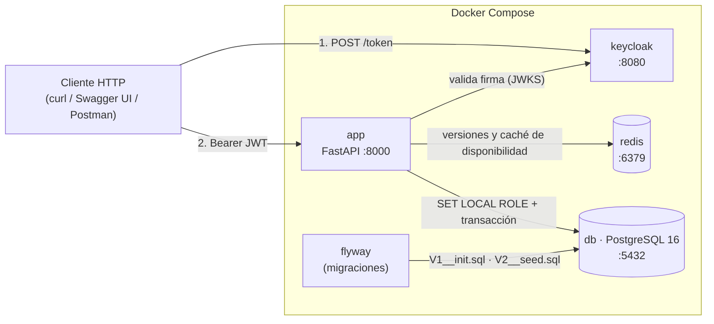
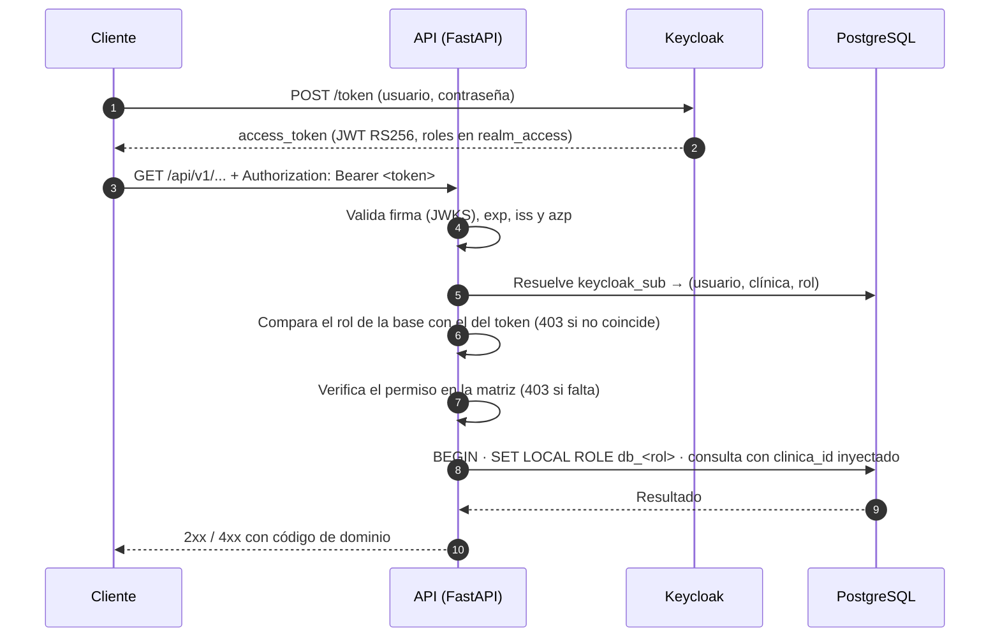
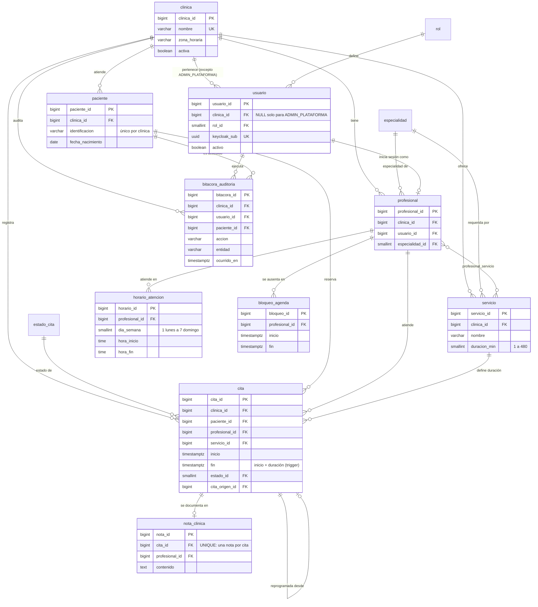
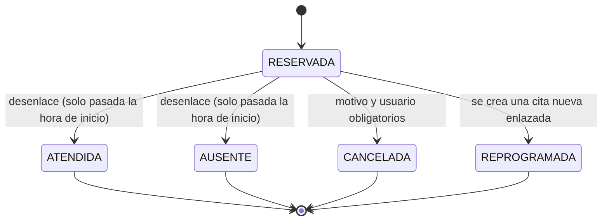

# MediCitas

**Plataforma SaaS multi-tenant de gestión de citas médicas — Etapa 1 (OLTP)**

Proyecto semestral · Arquitectura e Ingeniería de Datos · Unidad de Ingeniería en Computación, Sede Central Cartago · Tecnológico de Costa Rica
Profesor: Kenneth Obando


---

## Tabla de contenidos

1. [Descripción general](#1-descripción-general)
2. [La pregunta rectora](#2-la-pregunta-rectora)
3. [Arquitectura](#3-arquitectura)
4. [Stack tecnológico](#4-stack-tecnológico)
5. [Inicio rápido](#5-inicio-rápido)
6. [Configuración](#6-configuración)
7. [Autenticación y usuarios de prueba](#7-autenticación-y-usuarios-de-prueba)
8. [Estructura del repositorio](#8-estructura-del-repositorio)
9. [Modelo de datos](#9-modelo-de-datos)
10. [Decisiones de diseño](#10-decisiones-de-diseño)
11. [Contrato de la API](#11-contrato-de-la-api)
12. [Matriz de permisos](#12-matriz-de-permisos)
13. [Requisitos funcionales e invariantes: trazabilidad](#13-requisitos-funcionales-e-invariantes-trazabilidad)
14. [Pruebas](#14-pruebas)
15. [Criterios de aceptación](#15-criterios-de-aceptación)
16. [Limitaciones conocidas](#16-limitaciones-conocidas)
17. [Documentación adicional](#17-documentación-adicional)
18. [Equipo](#18-equipo)
19. [Declaración de uso de inteligencia artificial](#19-declaración-de-uso-de-inteligencia-artificial)

---

## 1. Descripción general

MediCitas es un producto que una empresa vende como servicio a muchas clínicas a la vez, de modo que **los datos de cada clínica permanecen estrictamente aislados de los demás**. Esta primera etapa construye el núcleo transaccional (OLTP); la Etapa 2 lo convertirá en una plataforma analítica distribuida.

El dominio clínico se eligió porque sus datos son información personal sensible, lo que convierte la seguridad y la privacidad en requisitos verificables y no en advertencias teóricas.

### Actores

| Actor | Responsabilidad |
|---|---|
| **Administrador de plataforma** | Pertenece a la empresa que vende el servicio. Da de alta clínicas y **no** accede a datos clínicos de ninguna de ellas. |
| **Administrador de clínica** | Gestiona usuarios, profesionales y el catálogo de servicios de su clínica. Es el único que consulta la bitácora de auditoría. |
| **Recepción** | Registra pacientes y opera la agenda: reserva, reprograma, cancela y registra el desenlace de las citas. |
| **Profesional de salud** | Consulta su propia agenda y redacta la nota clínica de las citas que atendió. |

> El paciente **no** es usuario del sistema en esta etapa: lo atiende recepción.

### Alcance funcional

- Alta de clínicas, usuarios, servicios y profesionales (RF1–RF4).
- Horarios semanales, bloqueos de agenda y cálculo de disponibilidad (RF5–RF8).
- Ciclo de vida completo de la cita: reservar, reprogramar, cancelar y registrar desenlace (RF9–RF13).
- Pacientes, historial y notas clínicas (RF14–RF16).
- Autenticación delegada, autorización por rol y bitácora de auditoría *append-only* (RF17–RF19).
- Agenda del día y conteo de citas por estado (RF20–RF21).

---

## 2. La pregunta rectora

> *Dos recepcionistas reservan el último espacio de la agenda exactamente al mismo tiempo. ¿Qué hace el sistema, por qué, y cómo se demuestra?*

**Qué hace.** Exactamente una reserva es concedida (`201`); la otra recibe `409 ESPACIO_TOMADO`. Nunca hay dos citas vigentes solapadas para un profesional.

**Por qué.** La decisión la toma el motor de base de datos, no la aplicación. La tabla `cita` declara una *exclusion constraint* sobre `(profesional_id, tstzrange(inicio, fin))` restringida a citas vigentes (`estado_id = 1`). Cuando dos transacciones intentan insertar intervalos solapados, la segunda espera al *commit* de la primera y recibe `exclusion_violation` (SQLSTATE `23P01`), que la API traduce a `409 ESPACIO_TOMADO`. No existe un `SELECT` previo "para verificar": esa comprobación sería en sí misma una condición de carrera.

**Cómo se demuestra.** Mediante una prueba automatizada de carrera con dos clientes concurrentes que compiten por el último espacio y producen exactamente una reserva concedida. Ver [§14 Pruebas](#14-pruebas).

---

## 3. Arquitectura



### Responsabilidad de cada servicio

| Servicio | Imagen | Rol en el sistema | Puerto en el host |
|---|---|---|---|
| `app` | Construida desde `./Backend` (Python 3.12) | API REST de dominio | `8000` |
| `db` | `postgres:16` | Fuente de verdad transaccional | `5433` |
| `redis` | `redis:7-alpine` | Caché de disponibilidad (nunca almacén primario) | `6380` |
| `keycloak` | `quay.io/keycloak/keycloak:26.0` | Proveedor de identidad OIDC (importa el *realm* al arrancar) | `8080` |
| `flyway` | `flyway/flyway:latest` | Aplica las migraciones y termina | — |

Los servicios se comunican entre sí **por su nombre dentro de la red de Compose** (`db`, `redis`, `keycloak`), nunca por direcciones IP fijas.

### Orden de arranque

`db` y `redis` se declaran *healthy* → `flyway` aplica el esquema y los datos semilla → `app` arranca solo cuando `flyway` terminó con éxito.

### Flujo de una petición autenticada



---

## 4. Stack tecnológico

| Capa | Tecnología | Notas |
|---|---|---|
| Lenguaje y *framework* | Python 3.12 · FastAPI · Uvicorn | API asíncrona con documentación OpenAPI automática |
| Acceso a datos | `psycopg` 3 + `psycopg_pool` | SQL parametrizado, sin ORM; el *pool* es compartido por todas las clínicas |
| Base de datos | PostgreSQL 16 | Extensión `btree_gist` para las *exclusion constraints* |
| Migraciones | Flyway | `V1__init.sql` (esquema) y `V2__seed.sql` (datos semilla) |
| Identidad | Keycloak 26 (OIDC) | Validación local con `PyJWT` contra las llaves públicas (JWKS) |
| Caché | Redis 7 | Caché de disponibilidad con invalidación por versión |
| Orquestación | Docker + Docker Compose | Un solo comando levanta todo |

---

## 5. Inicio rápido

### Requisitos previos

- [Docker](https://docs.docker.com/get-docker/) 24 o superior con Docker Compose v2.
- Puertos libres en el host: `8000`, `8080`, `5433` y `6380`.

### Pasos

```bash
# 1. Clonar el repositorio
git clone <URL-DEL-REPOSITORIO>
cd Proyecto-DB-II

# 2. Crear el archivo de entorno a partir de la plantilla
cp .env.example .env          # en PowerShell: Copy-Item .env.example .env

# 3. Levantar todo el sistema
docker compose up
```

No se requieren pasos manuales adicionales: el esquema queda creado, los datos semilla cargados y el *realm* de Keycloak configurado con sus roles y usuarios de prueba.

### Verificar que el sistema está listo

| Recurso | URL |
|---|---|
| Estado de la API (público) | <http://localhost:8000/health> → `{"estado":"ok"}` |
| Documentación interactiva (Swagger UI) | <http://localhost:8000/docs> |
| Especificación OpenAPI | <http://localhost:8000/openapi.json> |
| Consola de Keycloak | <http://localhost:8080> (`admin` / `admin123`, valores del `.env`) |

> La primera vez, Keycloak puede tardar unos segundos en importar el *realm*; la API responde de inmediato, pero los tokens solo se pueden pedir cuando Keycloak termina de arrancar.

### Detener y reiniciar desde cero

```bash
docker compose down            # detiene los servicios y conserva los datos
docker compose down -v         # además elimina el volumen de PostgreSQL (estado limpio)
```

Tras `down -v`, el siguiente `docker compose up` vuelve a crear el esquema y a cargar los datos semilla.

### Primera llamada de prueba

```bash
# Obtener un token como administrador de la Clínica Demo Norte
TOKEN=$(curl -s -X POST \
  http://localhost:8080/realms/medicitas/protocol/openid-connect/token \
  -d grant_type=password \
  -d client_id=medicitas-api \
  -d username=admin1 \
  -d 'password=Medicitas123!' | python3 -c "import sys, json; print(json.load(sys.stdin)['access_token'])")

# Listar los servicios de su clínica
curl -s http://localhost:8000/api/v1/servicios -H "Authorization: Bearer $TOKEN"
```

---

## 6. Configuración

Todas las variables se definen en `.env` (copia de `.env.example`). El archivo `.env` está en `.gitignore` y no debe versionarse.

| Variable | Valor por defecto | Descripción |
|---|---|---|
| `DB_USER` | `MediCitas` | Usuario de PostgreSQL |
| `DB_PASSWORD` | `MediCitas123` | Contraseña de PostgreSQL |
| `DB_NAME` | `MediCitas` | Nombre de la base de datos |
| `DB_POOL_MAX` | `20` | Tamaño máximo del *pool* de conexiones |
| `MAX_RETRIES` | `3` | Reintentos ante *deadlock* (`40P01`) o fallo de serialización (`40001`) |
| `REDIS_URL` | `redis://redis:6379/0` | URL de Redis dentro de la red de Compose |
| `CACHE_TTL_SECONDS` | `300` | TTL de las entradas de caché (solo limpia llaves huérfanas; no es el mecanismo de invalidación) |
| `SLOT_STEP_MIN` | `15` | Granularidad, en minutos, con la que se generan los espacios disponibles |
| `KEYCLOAK_ADMIN` | `admin` | Administrador de la consola de Keycloak |
| `KEYCLOAK_ADMIN_PASSWORD` | `admin123` | Contraseña de la consola de Keycloak |
| `KEYCLOAK_REALM` | `medicitas` | Nombre del *realm* |
| `KEYCLOAK_CLIENT_ID` | `medicitas-api` | *Client* OIDC de la aplicación |
| `KEYCLOAK_PUBLIC_URL` | `http://localhost:8080` | URL pública de Keycloak; define el emisor (`iss`) de los tokens |
| `KEYCLOAK_PORT` | `8080` (opcional) | Puerto publicado de Keycloak |
| `OIDC_ISSUER` | `http://localhost:8080/realms/medicitas` | Emisor esperado en los tokens |
| `OIDC_JWKS_URL` | `http://keycloak:8080/realms/medicitas/protocol/openid-connect/certs` | Llaves públicas, consultadas por nombre de servicio dentro de la red |
| `OIDC_CLIENT_ID` | `medicitas-api` | Valor esperado del claim `azp` |

> **Aviso.** Las credenciales de `.env.example` son exclusivamente para desarrollo y evaluación local. No deben usarse en ningún entorno real.

---

## 7. Autenticación y usuarios de prueba

La autenticación está **delegada en Keycloak**: la aplicación no implementa inicio de sesión ni emite o firma tokens. Solo valida los que recibe.

### Cómo se valida un token

1. **Firma, expiración, emisor y *client*.** Se verifica la firma RS256 contra las llaves públicas del proveedor (JWKS), además de `exp`, `iss` y que el claim `azp` sea `medicitas-api`.
2. **La clínica no viene del token ni de la petición.** Se resuelve en la tabla `usuario` a partir del claim `sub`. Así se sostiene el invariante I5: manipular parámetros no cambia la clínica.
3. **El rol efectivo es el de la base**, y el token debe llevar ese mismo rol en `realm_access.roles`; de lo contrario, `403`.
4. **Permiso.** Cada ruta exige un permiso de la [matriz](#12-matriz-de-permisos).

| Situación | Respuesta |
|---|---|
| Sin token, malformado, expirado o con firma inválida | `401 NO_AUTENTICADO` |
| Token válido pero el usuario no está registrado o está inactivo (o su clínica) | `403 USUARIO_NO_REGISTRADO` |
| Token válido sin el rol que tiene el usuario en la base | `403 ROL_NO_AUTORIZADO` |
| Token válido, rol sin permiso para la operación | `403 SIN_PERMISO` |
| Keycloak inalcanzable al validar | `503 PROVEEDOR_NO_DISPONIBLE` |

### Usuarios de prueba

Todos comparten la contraseña **`Medicitas123!`** y se obtienen del *realm* `medicitas` (archivo `keycloak/medicitas-realm.json`).

| Usuario | Rol | Clínica | ¿Cuenta con datos semilla? |
|---|---|---|---|
| `plataforma` | `ADMIN_PLATAFORMA` | — (ninguna) | Sí |
| `admin1` | `ADMIN_CLINICA` | Clínica Demo Norte | Sí |
| `recep1a` | `RECEPCION` | Clínica Demo Norte | Sí |
| `recep1b` | `RECEPCION` | — | No (solo existe en Keycloak; sin registro en la base) |
| `prof1a` | `PROFESIONAL` (General) | Clínica Demo Norte | Sí |
| `prof1b` | `PROFESIONAL` (Pediatría) | Clínica Demo Norte | Sí |
| `admin2` | `ADMIN_CLINICA` | Clínica Demo Sur | Sí |
| `recep2a` | `RECEPCION` | Clínica Demo Sur | Sí |
| `recep2b` | `RECEPCION` | — | No (solo existe en Keycloak; sin registro en la base) |
| `prof2a` | `PROFESIONAL` (General) | Clínica Demo Sur | Sí |
| `prof2b` | `PROFESIONAL` | — | No (solo existe en Keycloak; sin registro en la base) |
| `admin3`, `recep3a`, `recep3b`, `prof3a`, `prof3b` | `ADMIN_CLINICA` / `RECEPCION` / `PROFESIONAL` | Reservados para una tercera clínica | No (sin datos semilla todavía) |

Un usuario que existe en Keycloak pero no en la tabla `usuario` recibe `403 USUARIO_NO_REGISTRADO`: la identidad la da el proveedor, pero la **pertenencia a una clínica** la da la base. El identificador `sub` de cada usuario es fijo (`00000000-0000-4000-8000-0000000000NN`) para que el *seed* pueda referenciarlo.

### Obtener un token

**Bash / curl**

```bash
curl -s -X POST http://localhost:8080/realms/medicitas/protocol/openid-connect/token \
  -d grant_type=password -d client_id=medicitas-api \
  -d username=recep1a -d 'password=Medicitas123!'
```

**PowerShell**

```powershell
function Get-Token($user) {
  (Invoke-RestMethod -Method Post `
    -Uri "http://localhost:8080/realms/medicitas/protocol/openid-connect/token" `
    -Body @{ grant_type="password"; client_id="medicitas-api"; username=$user; password='Medicitas123!' }
  ).access_token
}

$t = Get-Token recep1a
Invoke-RestMethod http://localhost:8000/api/v1/pacientes -Headers @{ Authorization = "Bearer $t" }
```

Los tokens duran 30 minutos. En Swagger UI (`/docs`), el botón **Authorize** acepta el `access_token` obtenido.

---

## 8. Estructura del repositorio

```text
Proyecto-DB-II/
├── docker-compose.yml              # Orquestación: db, redis, flyway, keycloak, app y perfil test
├── .env.example                    # Plantilla de variables de entorno
├── README.md
├── Backend/
│   ├── Dockerfile
│   ├── requirements.txt
│   ├── pytest.ini                  # Configuración de Pytest y marcadores
│   ├── app/
│   │   ├── main.py                 # Aplicación FastAPI, ciclo de vida y manejo global de errores
│   │   ├── config.py               # Configuración desde variables de entorno
│   │   ├── auth.py                 # Validación del token OIDC y dependencia de permisos
│   │   ├── permisos.py             # Matriz de permisos y mapeo rol → rol de base de datos
│   │   ├── tenancy.py              # Guarda de aislamiento entre clínicas (I5)
│   │   ├── db.py                   # Pool, transacciones, reintentos y traducción de errores del motor
│   │   ├── cache.py                # Caché de disponibilidad en Redis
│   │   ├── common.py               # Utilidades compartidas y auditoría
│   │   ├── schemas.py              # Modelos de entrada (Pydantic)
│   │   └── routers/
│   │       ├── admin.py            # RF1–RF4: clínicas, usuarios, servicios, profesionales
│   │       ├── agenda.py           # RF5–RF8: horarios, bloqueos, disponibilidad
│   │       ├── citas.py            # RF9–RF13, RF20, RF21: ciclo de vida de la cita
│   │       ├── pacientes.py        # RF14, RF16: pacientes e historial
│   │       ├── notas.py            # RF15: notas clínicas
│   │       └── auditoria.py        # RF19: consulta de la bitácora
│   └── tests/
│       └── unit/
│           ├── __init__.py
│           ├── test_permisos.py    # Pruebas unitarias de la matriz de permisos por rol
│           ├── test_slots.py       # Pruebas unitarias del cálculo de bloques disponibles
│           ├── test_tenancy.py     # Pruebas unitarias de los guardas de aislamiento (I5)
│           └── integration/
│               ├── __init__.py
│               ├── conftest.py                     # Fixtures y clientes HTTP autenticados contra Keycloak
│               ├── test_aislamiento.py             # I5: intentos deliberados de fuga entre clínicas
│               ├── test_auditoria.py               # I6 / RF18–RF19: bitácora append-only y auditoría
│               ├── test_cache.py                   # I7 / I8: coherencia e invalidación de caché Redis
│               ├── test_cache_disponibilidad.py    # I8: reprogramación, cambios de horario y benchmark
│               ├── test_carrera.py                 # I1: concurrencia y carrera por el último espacio
│               ├── test_ciclo_cita.py              # RF9–RF13, I2, I4, I7: ciclo de vida y estados
│               ├── test_horarios_bloqueos.py       # I3 / RF5–RF6: horarios semanales, bloqueos y conflictos
│               ├── test_identidad.py               # RF17: validación OIDC (401/403/200) y manejo de errores
│               ├── test_motor.py                   # I5 / I6: roles de mínimo privilegio, FKs y triggers en BD
│               └── test_servicios_duracion.py      # I4 / RF3: duración de cita fijada por el servicio
├── Base de datos/
│   ├── Scripts/
│   │   ├── V1__init.sql            # Esquema, índices, triggers, roles de BD y catálogos
│   │   └── V2__seed.sql            # Datos semilla
│   ├── Tests/                      # Migraciones y semilla aislada para db_test
│   └── Markdowns/                  # Diccionario de datos y diseño de la base
├── Decisiones/                     # Comparación de estrategias de multi-tenancy y decisión
├── keycloak/
│   ├── medicitas-realm.json        # Realm versionado: roles, client y usuarios de prueba
│   └── guia.md                     # Cómo obtener un token
└── Documentos/                     # Enunciado de la Etapa 1
```

---

## 9. Modelo de datos

El esquema se define en [`Base de datos/Scripts/V1__init.sql`](Base%20de%20datos/Scripts/V1__init.sql). El diccionario de datos completo, atributo por atributo, está en [`Base de datos/Markdowns/`](Base%20de%20datos/Markdowns/).

### Diagrama entidad-relación



> `clinica_id` está presente en todas las tablas de negocio, y las claves foráneas son **compuestas** (incluyen `clinica_id`); el diagrama las simplifica por legibilidad.

### Catálogos globales

| Tabla | Contenido |
|---|---|
| `rol` | `1 ADMIN_PLATAFORMA`, `2 ADMIN_CLINICA`, `3 RECEPCION`, `4 PROFESIONAL` |
| `estado_cita` | `1 RESERVADA`, `2 ATENDIDA`, `3 AUSENTE`, `4 CANCELADA`, `5 REPROGRAMADA` |
| `especialidad` | Medicina General, Pediatría, Cardiología, Dermatología, Ginecología, Ortopedia |

### Máquina de estados de la cita



Solo `RESERVADA` es un estado vigente; los otros cuatro son finales y no admiten salida. La regla vive en el trigger `trg_cita_transicion_estado`, de modo que ninguna ruta puede saltársela.

### Normalización

El esquema está en **tercera forma normal**. Las desnormalizaciones deliberadas son dos:

1. **`cita.fin`** es derivable de `inicio` + `servicio.duracion_min`, pero se almacena porque las *exclusion constraints* (I1, I2) la necesitan, y porque así un cambio posterior en la duración del servicio no altera citas ya agendadas. Un trigger la mantiene consistente (I4).
2. **`clinica_id` en las tablas hijas** es redundante respecto a la cadena de claves foráneas, pero habilita las claves foráneas compuestas que impiden referencias entre clínicas.

### Datos semilla

`V2__seed.sql` carga, con **fechas relativas a `CURRENT_DATE`** para que la agenda siempre tenga citas futuras y pasadas:

- **Clínica Demo Norte:** administrador, recepcionista, tres profesionales (General, Pediatría, Cardiología), cuatro servicios (uno inactivo), horarios de 08:00 a 17:00 todos los días, cuatro pacientes, un bloqueo de agenda y citas en cada estado (reservada, atendida, ausente, cancelada y un par reprogramado), una nota clínica y registros de bitácora.
- **Clínica Demo Sur:** administrador, recepcionista, un profesional, un servicio, un paciente y una cita, pensada para comprobar el aislamiento entre clínicas.

---

## 10. Decisiones de diseño

Cada decisión se acompaña de su argumento: alternativas consideradas, qué se ganó y qué se sacrificó. El detalle completo de multi-tenancy está en [`Decisiones/`](Decisiones/).

### 10.1 Multi-tenancy: tabla compartida con columna discriminadora

Se compararon cuatro estrategias: base de datos por clínica, esquema por clínica, tabla compartida con columna discriminadora y tabla compartida con *Row-Level Security*.

| Criterio | BD por clínica | Esquema por clínica | **Columna discriminadora** | RLS |
|---|---|---|---|---|
| Fuerza del aislamiento | Muy alta | Alta | Media (depende de la aplicación) | Alta (lo aplica el motor) |
| Riesgo de fuga por error de código | Muy bajo | Bajo | Mayor | Bajo |
| Alta de una clínica | Crear y migrar una base | Crear y migrar un esquema | Insertar una fila | Insertar una fila |
| Migraciones | N veces | N veces | Una vez | Una vez |
| Conexiones y recursos | Un *pool* por base | *Pool* compartido, catálogo crece | Un *pool* compartido | Un *pool* compartido |
| Analítica de la Etapa 2 | Unir N bases | Unir N esquemas | Directa | Directa |
| Complejidad | Alta | Media | Baja | Media |

**Decisión:** columna discriminadora `clinica_id`. **Ganancia:** una sola estructura, migraciones únicas, un *pool*, y datos listos para la analítica de la Etapa 2. **Sacrificio:** el motor no corrige una consulta sin filtro, de modo que el riesgo de I5 queda en el código.

**Cómo se compensa** (defensa en profundidad):

| Capa | Mecanismo | Dónde |
|---|---|---|
| Identidad | La clínica sale de la fila `usuario` (vía `sub`), nunca de la petición. Los modelos Pydantic ignoran un `clinica_id` enviado en el cuerpo, y las rutas no lo declaran como parámetro. | `auth.py`, `schemas.py` |
| Acceso a datos | Toda consulta de negocio pasa por `Tx`, que **exige** el marcador `%(clinica_id)s` en el SQL (si falta, `TenantGuardError`) y **sobrescribe** cualquier valor que el llamador intente pasar. | `tenancy.py`, `db.py` |
| Integridad referencial | Claves foráneas **compuestas** `(clinica_id, id)`: la base impide que una cita de A referencie un paciente de B. | `V1__init.sql` |
| Privilegios | Roles de base de datos de mínimo privilegio y `UPDATE` por columnas: ningún rol puede cambiar el `clinica_id` de una fila existente. | `V1__init.sql` |
| Verificación | Pruebas automatizadas de fuga con intentos deliberados de romper el aislamiento. | [§14](#14-pruebas) |

> La guarda de `tenancy.py` es una barrera contra el olvido, no un analizador semántico de SQL. Por eso la complementan las demás capas.

#### ¿Se utiliza Row-Level Security (RLS)?

**No.** El proyecto no define políticas RLS (`ENABLE ROW LEVEL SECURITY` / `CREATE POLICY`) en ninguna tabla. Se evaluó y se descartó (ver la comparación anterior) por la complejidad de fijar la clínica de la sesión en cada transacción y de mantener políticas por tabla.

Consecuencias que se asumen de forma explícita:

- **El motor no filtra filas por clínica.** La separación entre clínicas la garantiza la aplicación, que toma `clinica_id` de la identidad validada e inyecta el filtro en toda consulta de negocio. El motor aporta únicamente las claves foráneas compuestas y los privilegios por rol y por columna.
- **Los roles de base de datos limitan tablas y columnas, no filas.** Por ejemplo, `db_profesional` puede leer `cita`, pero el motor no impide que lea citas de otro profesional de su misma clínica.
- **"Solo los propios" del profesional** (horarios, bloqueos, desenlace y notas de citas propias) se aplica en la capa de acceso (`exigir_profesional_propio`, `mi_profesional_id`), no en el motor.
- **Riesgo residual:** un error en la capa de acceso podría exponer datos. Se mitiga con la guarda de `Tx`, las claves foráneas compuestas y las pruebas de fuga de [§14.4 b](#b-pruebas-de-aislamiento-i5).

### 10.2 Transacciones y concurrencia

| Aspecto | Decisión |
|---|---|
| Nivel de aislamiento | `READ COMMITTED`, fijado explícitamente en cada transacción (`SET TRANSACTION ISOLATION LEVEL`). |
| Quién arbitra la carrera por un espacio | La *exclusion constraint* `ex_cita_profesional_sin_solape` (I1), no la aplicación. Evita el patrón *check-then-insert*. |
| Reserva (RF9) | Un único `INSERT` en una transacción. `23P01` → `409 ESPACIO_TOMADO` (o `409 PACIENTE_OCUPADO` si el que choca es I2). |
| Reprogramación (RF10) | En **una** transacción: bloquea la cita (`SELECT … FOR UPDATE`), la pasa a `REPROGRAMADA` e inserta la nueva. Si la inserción falla, todo se revierte y la cita original sigue vigente: nunca queda duplicada ni con los dos espacios ocupados. |
| Cancelación y desenlace | `SELECT … FOR UPDATE` antes de cambiar el estado, para serializar cambios concurrentes sobre la misma cita. |
| *Deadlock* y serialización | Se reintentan `40P01` y `40001` hasta `MAX_RETRIES` veces con espera aleatoria creciente (*jitter*). Agotados los reintentos: `503 REINTENTAR`. |
| Efectos secundarios | La invalidación de caché se ejecuta **después del *commit*** (`tras_commit`); un fallo ahí nunca revierte una operación ya confirmada. |

**Por qué `READ COMMITTED` y no un nivel más alto.** La corrección de las operaciones críticas no depende del aislamiento de la transacción sino de restricciones declarativas del motor (exclusion constraints, claves foráneas, triggers), que se evalúan sobre el estado confirmado. Subir a `SERIALIZABLE` añadiría fallos de serialización sin ganar garantías adicionales sobre I1 e I2.

### 10.3 Caché de disponibilidad (Redis)

La consulta de espacios (RF7) es la más frecuente, por lo que se sirve desde Redis. **PostgreSQL sigue siendo la fuente de verdad**: Redis nunca se usa como almacén primario.

| Aspecto | Diseño |
|---|---|
| Clave | `disp:{clinica}:{profesional}:{fecha}:{servicio}:p{ver_prof}:d{ver_dia}` |
| Alcance de una entrada | Los espacios de **un** profesional, **una** fecha local de la clínica y **un** servicio (la duración del servicio cambia los espacios). La clínica forma parte de la clave: no hay entradas compartidas entre *tenants*. |
| Invalidación | **Por versión**, no por expiración. Dos contadores: `ver:dia:{clínica}:{prof}:{fecha}` (cambia al reservar, cancelar, reprogramar o registrar desenlace) y `ver:prof:{clínica}:{prof}` (cambia al editar horarios, bloqueos o servicios del profesional). |
| Orden de operaciones | El lector lee las versiones **antes** de consultar la base; el escritor hace `INCR` **después** del *commit*. Un lector con datos anteriores al *commit* guarda su resultado bajo la versión vieja, que nadie vuelve a pedir. |
| Resultado | Una reserva concedida invalida de inmediato toda copia previa de esa agenda (**I8**) sin esperar a que expire ninguna entrada. El TTL solo limpia llaves huérfanas. |
| Falla de Redis | Se responde desde la base: la caché nunca puede dar una respuesta falsa. |
| Filtrado temporal | El resultado se cachea sin depender de la hora actual; los espacios ya pasados se descartan al servir la respuesta. |

**Medición antes y después de introducir la caché:** ver [§14.5](#145-medición-de-la-caché)._

### 10.4 Protección de datos y auditoría

**Roles de base de datos (mínimo privilegio).** Cuatro roles `NOLOGIN`, uno por rol del dominio. La aplicación activa el que corresponde con `SET LOCAL ROLE` al inicio de cada transacción, de modo que el motor, y no solo la aplicación, limita lo que cada perfil puede hacer.

| Rol de BD | Corresponde a | Privilegios principales |
|---|---|---|
| `db_plataforma` | Administrador de plataforma | Solo puede ejecutar `crear_clinica(...)` y leer catálogos y `clinica`. Sin acceso a pacientes, citas, notas ni bitácora. |
| `db_admin_clinica` | Administrador de clínica | `SELECT`/`INSERT` y `UPDATE` por columnas sobre usuarios, profesionales, servicios, pacientes y citas; gestión de horarios y bloqueos; `SELECT`/`INSERT` en bitácora. **Sin acceso a `nota_clinica`.** |
| `db_recepcion` | Recepción | `SELECT`/`INSERT` y `UPDATE` por columnas sobre pacientes y citas; lectura de la configuración de agenda; `INSERT` en bitácora. **Sin acceso a `nota_clinica`.** |
| `db_profesional` | Profesional de salud | Lectura de citas, pacientes y agenda; gestión de horarios y bloqueos; cambio de estado de citas; lectura y escritura de `nota_clinica`; `INSERT` en bitácora. |

Ningún rol tiene `DELETE` ni `TRUNCATE` sobre tablas de datos clínicos (las bajas son lógicas). La alta de una clínica y de su primer administrador se hace con la función `crear_clinica(...)`, `SECURITY DEFINER`, en una sola transacción; el administrador de plataforma no puede hacer `INSERT` directo en `usuario`.

**Bitácora *append-only* (I6), protegida en el motor.** Doble barrera:

1. **Privilegios.** Ningún rol recibe `UPDATE`, `DELETE` ni `TRUNCATE` sobre `bitacora_auditoria`. Solo el administrador de clínica puede leerla.
2. **Triggers.** `trg_bitacora_no_update_delete` y `trg_bitacora_no_truncate` rechazan la operación aunque, por error, se otorgara el permiso en el futuro.

Cada registro de auditoría se inserta **dentro de la misma transacción** que el acceso auditado: si el acceso se revierte, el registro también, y no puede existir un acceso sin su huella.

| Acción auditada | `accion` | `entidad` |
|---|---|---|
| Crear paciente | `CREACION` | `PACIENTE_CONTACTO` |
| Leer el detalle de un paciente (incluye teléfono y correo) | `LECTURA` | `PACIENTE_CONTACTO` |
| Actualizar un paciente, **solo si cambia teléfono o correo** | `ACTUALIZACION` | `PACIENTE_CONTACTO` |
| Crear, editar o leer una nota clínica | `CREACION` / `ACTUALIZACION` / `LECTURA` | `NOTA_CLINICA` |

El listado de pacientes (`GET /pacientes`) **no** devuelve datos de contacto, por lo que no genera registros.

### 10.5 Cómo se garantiza cada invariante

| Invariante | Mecanismo principal | Capa |
|---|---|---|
| **I1.** Un profesional nunca tiene dos citas vigentes solapadas | `EXCLUDE USING gist` `ex_cita_profesional_sin_solape` (parcial: `estado_id = 1`) | Motor |
| **I2.** Un paciente nunca tiene dos citas vigentes solapadas | `EXCLUDE USING gist` `ex_cita_paciente_sin_solape` | Motor |
| **I3.** Toda cita vigente cae dentro del horario y fuera de los bloqueos | Trigger `trg_cita_valida_agenda` (zona horaria de la clínica); además valida profesional activo y servicio habilitado | Motor |
| **I4.** La duración la determina el servicio | Trigger `trg_cita_fin_por_servicio` calcula `fin = inicio + duracion_min` e ignora cualquier `fin` enviado | Motor |
| **I5.** Ningún dato de una clínica es accesible desde otra | Identidad → clínica, guarda `Tx`, claves foráneas compuestas, roles de BD, pruebas de fuga | Aplicación + motor |
| **I6.** La bitácora no admite modificación ni borrado | Privilegios + triggers `BEFORE UPDATE/DELETE/TRUNCATE` | Motor |
| **I7.** Cancelar o reprogramar libera el espacio de inmediato | La cita sale de `estado_id = 1` en la misma transacción; invalidación de caché tras el *commit* | Motor + aplicación |
| **I8.** La disponibilidad nunca contradice la base, ni desde la caché | Invalidación por versión en la clave de caché | Aplicación |

Otras reglas de integridad en el motor: máquina de estados de la cita (RF13), desenlace solo pasada la hora de inicio (RF12), cancelación con motivo y autor obligatorios (`ck_cita_cancelacion`), nota clínica solo sobre cita `ATENDIDA` y escrita por el profesional de la cita (RF15), el usuario de un profesional debe tener rol `PROFESIONAL`, y la especialidad del profesional debe coincidir con la del servicio.

### 10.6 Índices

Cada índice sirve una consulta concreta. Las *exclusion constraints* de `cita` y `horario_atencion` crean además sus propios índices GiST.

| Índice | Tabla | Columnas | Consulta que sirve |
|---|---|---|---|
| `ix_cita_prof_inicio` | `cita` | `(profesional_id, inicio)` parcial `WHERE estado_id = 1` | Disponibilidad (RF7, RF8) y agenda del profesional (RF20) |
| `ix_cita_clinica_inicio` | `cita` | `(clinica_id, inicio)` | Agenda de la clínica (RF20) y conteo por estado (RF21) |
| `ix_cita_paciente_inicio` | `cita` | `(paciente_id, inicio)` | Historial del paciente (RF16) |
| `ix_horario_prof_dia` | `horario_atencion` | `(profesional_id, dia_semana)` | Bloques del profesional en un día (RF7) |
| `ix_bloqueo_prof_rango` | `bloqueo_agenda` | GiST `(profesional_id, tstzrange(inicio, fin))` | Bloqueos de una fecha y conflictos (RF6, RF7) |
| `ix_paciente_busqueda` | `paciente` | `(clinica_id, apellidos, nombre)` | Búsqueda de pacientes (RF14) |
| `ix_bitacora_clinica_fecha` | `bitacora_auditoria` | `(clinica_id, ocurrido_en)` | Bitácora por rango de fechas (RF19) |
| `ix_bitacora_paciente` | `bitacora_auditoria` | `(clinica_id, paciente_id)` | Bitácora por paciente (RF19) |
| `ix_bitacora_usuario` | `bitacora_auditoria` | `(clinica_id, usuario_id)` | Bitácora por usuario (RF19) |

**Plan de ejecución que justifica los índices (`EXPLAIN ANALYZE` de RF7):** _ver [§14.6](#146-índices-y-planes-de-ejecución)._

---

## 11. Contrato de la API

- **URL base:** `http://localhost:8000`
- **Prefijo:** `/api/v1` (excepto `/health`)
- **Formato:** JSON. Las fechas con hora se envían en ISO 8601 **con zona horaria** (por ejemplo `2026-12-01T08:00:00-06:00`); una fecha-hora sin zona es rechazada con `422`.
- **Autenticación:** `Authorization: Bearer <access_token>` en todas las rutas salvo `/health`.
- **Documentación interactiva:** `/docs` (Swagger UI) y `/redoc`.
- **Paginación:** donde aplica, `limit` y `offset`.

### 11.1 Formato de error

Todo error devuelve el mismo cuerpo:

```json
{
  "detail": {
    "codigo": "ESPACIO_TOMADO",
    "mensaje": "El espacio ya fue tomado por otra cita del profesional"
  }
}
```

La excepción son los errores de validación de formato de FastAPI (`422`), cuyo `detail` es una lista de errores de campo. El servicio **no se interrumpe** ante una entrada mal formada ni ante un recurso inexistente: responde con el código que corresponde y permanece operativo. Los errores inesperados devuelven `500 ERROR_INTERNO` sin filtrar detalles internos.

### 11.2 Catálogo de códigos de error

| HTTP | Código | Significado |
|---|---|---|
| 401 | `NO_AUTENTICADO` | Falta el token, es inválido o expiró |
| 403 | `USUARIO_NO_REGISTRADO` | El usuario no existe en la base o está inactivo |
| 403 | `ROL_NO_AUTORIZADO` | El token no lleva el rol que el usuario tiene en la base |
| 403 | `SIN_PERMISO` | El rol no puede realizar la operación (o recurso ajeno a un profesional) |
| 404 | `NO_ENCONTRADO` | El recurso no existe **en esta clínica** (no se distingue de uno de otra clínica) |
| 409 | `ESPACIO_TOMADO` | El profesional ya tiene una cita vigente en ese intervalo (I1) |
| 409 | `PACIENTE_OCUPADO` | El paciente ya tiene una cita vigente en ese intervalo (I2) |
| 409 | `HORARIO_SOLAPADO` | El bloque horario se solapa con otro del mismo profesional |
| 409 | `TRANSICION_INVALIDA` | Cambio de estado no permitido (RF12, RF13) |
| 409 | `CITA_NO_ATENDIDA` | La nota solo se adjunta a una cita atendida |
| 409 | `DUPLICADO` | Ya existe un registro con esos datos (restricción `UNIQUE`) |
| 409 | `AUTOBAJA` | Un administrador no puede darse de baja a sí mismo |
| 409 | `CONFLICTO` | Solapamiento no clasificado |
| 422 | `CITA_INVALIDA` | La cita no cumple el horario, el bloqueo, el servicio habilitado o debe iniciar en el futuro |
| 422 | `DATO_INVALIDO` | Dato fuera de rango, nulo o con formato incorrecto |
| 422 | `REFERENCIA_INVALIDA` | Una referencia no existe en esta clínica |
| 422 | `SERVICIO_NO_HABILITADO` | El profesional no atiende ese servicio |
| 422 | `RANGO_INVALIDO` / `RANGO_EXCESIVO` | Rango de fechas incoherente o mayor a 31 días |
| 422 | `SIN_CAMBIOS` | Un `PATCH` sin campos para actualizar |
| 503 | `REINTENTAR` | Conflicto transitorio (*deadlock*/serialización) tras agotar reintentos |
| 503 | `PROVEEDOR_NO_DISPONIBLE` | No se pudo validar el token contra Keycloak |
| 500 | `ERROR_INTERNO` | Error inesperado |

### 11.3 Resultados de la reserva (RF9)

La reserva distingue sus tres desenlaces:

| Desenlace | HTTP | Código |
|---|---|---|
| Concedida | `201 Created` | — (devuelve la cita) |
| Espacio ya tomado | `409 Conflict` | `ESPACIO_TOMADO` (o `PACIENTE_OCUPADO`) |
| Solicitud inválida | `422 Unprocessable Entity` | `CITA_INVALIDA`, `DATO_INVALIDO`, `REFERENCIA_INVALIDA` |

### 11.4 Endpoints

**Roles:** `AP` administrador de plataforma · `AC` administrador de clínica · `RE` recepción · `PR` profesional.
Las respuestas exitosas se indican entre paréntesis; todas las rutas protegidas pueden además devolver `401` y `403`.

#### Operación

| Método | Ruta | Descripción | Roles | Éxito |
|---|---|---|---|---|
| GET | `/health` | Estado del servicio (público) | — | 200 |

#### Administración (RF1–RF4)

| Método | Ruta | Descripción | Roles | Éxito | Errores específicos |
|---|---|---|---|---|---|
| POST | `/api/v1/clinicas` | **RF1.** Alta de clínica con su primer administrador | AP | 201 | 409 `DUPLICADO`, 422 |
| GET | `/api/v1/clinicas` | Lista de clínicas | AP | 200 | — |
| POST | `/api/v1/usuarios` | **RF2.** Alta de usuario en la clínica del administrador (`rol_id` ∈ {2, 3, 4}) | AC | 201 | 409 `DUPLICADO`, 422 |
| GET | `/api/v1/usuarios` | Usuarios de la clínica | AC | 200 | — |
| PATCH | `/api/v1/usuarios/{usuario_id}` | **RF2.** Cambio de rol, nombre o baja lógica | AC | 200 | 404, 409 `AUTOBAJA`, 422 |
| GET | `/api/v1/especialidades` | Catálogo global de especialidades | AC, RE, PR | 200 | — |
| POST | `/api/v1/servicios` | **RF3.** Alta de servicio | AC | 201 | 409 `DUPLICADO`, 422 |
| GET | `/api/v1/servicios` | Catálogo de servicios de la clínica | AC, RE, PR | 200 | — |
| PATCH | `/api/v1/servicios/{servicio_id}` | **RF3.** Modificar servicio (no altera citas ya agendadas) | AC | 200 | 404, 422 |
| POST | `/api/v1/profesionales` | **RF4.** Alta de profesional ligado a un usuario con rol `PROFESIONAL` | AC | 201 | 409, 422 |
| GET | `/api/v1/profesionales` | Profesionales con los servicios que atienden | AC, RE, PR | 200 | — |
| PATCH | `/api/v1/profesionales/{profesional_id}` | **RF4.** Modificar profesional o baja lógica | AC | 200 | 404, 422 |
| POST | `/api/v1/profesionales/{profesional_id}/servicios` | **RF4.** Habilita un servicio para el profesional | AC | 201 | 409 `DUPLICADO`, 422 |
| DELETE | `/api/v1/profesionales/{profesional_id}/servicios/{servicio_id}` | **RF4.** Retira un servicio del profesional | AC | 204 | 404 |

**Ejemplo — `POST /api/v1/clinicas`**

```json
{
  "nombre": "Clínica Demo Este",
  "zona_horaria": "America/Costa_Rica",
  "admin_keycloak_sub": "00000000-0000-4000-8000-000000000031",
  "admin_nombre": "Administrador Demo Este"
}
```

El usuario administrador debe existir previamente en Keycloak; su `sub` es el vínculo con la clínica.

#### Agenda y disponibilidad (RF5–RF8)

| Método | Ruta | Descripción | Roles | Éxito | Errores específicos |
|---|---|---|---|---|---|
| POST | `/api/v1/profesionales/{id}/horarios` | **RF5.** Agrega un bloque semanal (`dia_semana` 1–7, `hora_inicio`, `hora_fin`) | AC, PR (solo los propios) | 201 | 403, 409 `HORARIO_SOLAPADO`, 422 |
| GET | `/api/v1/profesionales/{id}/horarios` | Horario semanal del profesional | AC, RE, PR | 200 | — |
| DELETE | `/api/v1/horarios/{horario_id}` | **RF5.** Elimina un bloque semanal | AC, PR (solo los propios) | 204 | 403, 404 |
| POST | `/api/v1/profesionales/{id}/bloqueos` | **RF6.** Registra un bloqueo y devuelve las citas vigentes en conflicto | AC, PR (solo los propios) | 201 | 403, 422 |
| GET | `/api/v1/profesionales/{id}/bloqueos` | Bloqueos del profesional | AC, RE, PR | 200 | — |
| GET | `/api/v1/bloqueos/{bloqueo_id}/conflictos` | **RF6.** Citas vigentes dentro del bloqueo | AC, RE, PR | 200 | 404 |
| DELETE | `/api/v1/bloqueos/{bloqueo_id}` | Elimina un bloqueo | AC, PR (solo los propios) | 204 | 403, 404 |
| GET | `/api/v1/profesionales/{id}/disponibilidad` | **RF7.** Espacios libres en una fecha. Parámetros: `fecha` (`YYYY-MM-DD`), `servicio_id` | AC, RE, PR | 200 | 404, 422 `SERVICIO_NO_HABILITADO` |
| GET | `/api/v1/disponibilidad` | **RF8.** Profesionales con espacio para un servicio en un rango. Parámetros: `servicio_id`, `desde`, `hasta` (máx. 31 días) | AC, RE, PR | 200 | 422 `RANGO_INVALIDO` / `RANGO_EXCESIVO` |

Un bloqueo retira la disponibilidad hacia adelante, pero **no cancela** las citas ya reservadas que caigan dentro de él: se devuelven en `conflictos` para que recepción las reprograme.

**Ejemplo — `GET /api/v1/profesionales/1/disponibilidad?fecha=2026-12-01&servicio_id=1`**

```json
{
  "profesional_id": 1,
  "fecha": "2026-12-01",
  "servicio_id": 1,
  "espacios": [
    { "inicio": "2026-12-01T08:00:00-06:00", "fin": "2026-12-01T08:30:00-06:00" },
    { "inicio": "2026-12-01T08:15:00-06:00", "fin": "2026-12-01T08:45:00-06:00" }
  ]
}
```

Los espacios se generan cada `SLOT_STEP_MIN` minutos dentro de cada bloque horario, con la duración del servicio, descartando los que chocan con citas vigentes o bloqueos, y los que ya pasaron.

#### Ciclo de vida de la cita (RF9–RF13, RF20, RF21)

| Método | Ruta | Descripción | Roles | Éxito | Errores específicos |
|---|---|---|---|---|---|
| POST | `/api/v1/citas` | **RF9.** Reservar una cita | AC, RE | 201 | 409 `ESPACIO_TOMADO` / `PACIENTE_OCUPADO`, 422 `CITA_INVALIDA` |
| POST | `/api/v1/citas/{cita_id}/reprogramar` | **RF10.** Reprogramar una cita vigente (atómico) | AC, RE | 201 | 404, 409 `TRANSICION_INVALIDA` / `ESPACIO_TOMADO`, 422 |
| POST | `/api/v1/citas/{cita_id}/cancelar` | **RF11.** Cancelar (registra motivo y usuario) | AC, RE | 200 | 404, 409 `TRANSICION_INVALIDA` |
| POST | `/api/v1/citas/{cita_id}/desenlace` | **RF12.** Registrar `ATENDIDA` o `AUSENTE` (solo pasada la hora de inicio) | AC, RE, PR (solo sus citas) | 200 | 403, 404, 409 `TRANSICION_INVALIDA` |
| GET | `/api/v1/citas/{cita_id}` | Detalle de una cita | AC, RE, PR (solo sus citas) | 200 | 404 |
| GET | `/api/v1/agenda` | **RF20.** Agenda del día. Parámetros: `fecha`, `profesional_id` (opcional) | AC, RE, PR (solo la propia) | 200 | 403 |
| GET | `/api/v1/citas/conteo/por-estado` | **RF21.** Conteo por estado. Parámetros: `desde`, `hasta` | AC, RE | 200 | 422 `RANGO_INVALIDO` |

**Ejemplo — `POST /api/v1/citas`**

```json
{
  "paciente_id": 1,
  "profesional_id": 1,
  "servicio_id": 1,
  "inicio": "2026-12-01T09:00:00-06:00"
}
```

El campo `fin` **no** se envía: lo calcula el motor a partir de la duración del servicio (I4). La cita debe iniciar en el futuro.

**Ejemplo — `POST /api/v1/citas/{id}/cancelar`**

```json
{ "motivo": "El paciente solicitó posponer la consulta" }
```

**Ejemplo — `POST /api/v1/citas/{id}/desenlace`**

```json
{ "resultado": "ATENDIDA" }
```

**Ejemplo — `POST /api/v1/citas/{id}/reprogramar`**

```json
{ "inicio": "2026-12-02T10:00:00-06:00", "profesional_id": 2 }
```

`profesional_id` es opcional (por defecto se conserva el mismo profesional). La respuesta es la **nueva** cita, con `cita_origen_id` apuntando a la anterior, que queda en estado `REPROGRAMADA`.

#### Pacientes y ficha clínica (RF14–RF16)

| Método | Ruta | Descripción | Roles | Éxito | Errores específicos |
|---|---|---|---|---|---|
| POST | `/api/v1/pacientes` | **RF14.** Registrar paciente | AC, RE | 201 | 409 `DUPLICADO`, 422 |
| GET | `/api/v1/pacientes` | Búsqueda (`q`, `limit`, `offset`). **Sin** datos de contacto | AC, RE, PR | 200 | — |
| GET | `/api/v1/pacientes/{paciente_id}` | Detalle **con** contacto (**auditado**) | AC, RE, PR | 200 | 404 |
| PATCH | `/api/v1/pacientes/{paciente_id}` | **RF14.** Actualizar paciente (audita si cambia teléfono o correo) | AC, RE | 200 | 404, 422 |
| GET | `/api/v1/pacientes/{paciente_id}/citas` | **RF16.** Historial de citas con su estado | AC, RE, PR | 200 | 404 |
| POST | `/api/v1/citas/{cita_id}/nota` | **RF15.** Adjuntar nota a una cita atendida | PR (solo citas propias) | 201 | 403, 404, 409 `CITA_NO_ATENDIDA` |
| PUT | `/api/v1/citas/{cita_id}/nota` | **RF15.** Editar el contenido de la nota | PR (solo citas propias) | 200 | 403, 404 |
| GET | `/api/v1/citas/{cita_id}/nota` | **RF15.** Leer la nota (**auditado**) | PR (solo citas propias) | 200 | 403, 404 |

#### Auditoría (RF19)

| Método | Ruta | Descripción | Roles | Éxito |
|---|---|---|---|---|
| GET | `/api/v1/bitacora` | **RF19.** Bitácora con filtros `usuario_id`, `paciente_id`, `desde`, `hasta`, `limit` (1–500, def. 100), `offset` | AC | 200 |

La bitácora es *append-only*: no existen rutas de modificación ni de borrado, y el motor tampoco las permite.

---

## 12. Matriz de permisos

La matriz del enunciado es el **mínimo exigido**; esta implementación la respeta y la aplica en el servidor (`app/permisos.py`) y, además, en la base de datos mediante roles de mínimo privilegio.

| Operación | Adm. plataforma | Adm. clínica | Recepción | Profesional |
|---|:---:|:---:|:---:|:---:|
| Alta de clínicas (RF1) | ✅ | ❌ | ❌ | ❌ |
| Usuarios, servicios y profesionales (RF2–RF4) | ❌ | ✅ | ❌ | ❌ |
| Horarios y bloqueos (RF5, RF6) | ❌ | ✅ | ❌ | solo los propios |
| Consultar disponibilidad (RF7, RF8) | ❌ | ✅ | ✅ | ✅ |
| Reservar, reprogramar y cancelar (RF9–RF11) | ❌ | ✅ | ✅ | ❌ |
| Registrar desenlace (RF12) | ❌ | ✅ | ✅ | ✅ (solo sus citas) |
| Pacientes (RF14) | ❌ | ✅ | ✅ | solo lectura |
| Nota clínica (RF15) | ❌ | ❌ | ❌ | solo de citas propias |
| Historial del paciente (RF16) | ❌ | ✅ | ✅ (lectura) | ✅ |
| Bitácora de auditoría (RF19) | ❌ | ✅ | ❌ | ❌ |

Las operaciones de lectura de apoyo (catálogos, agenda del día, detalle de cita) se conceden a los roles clínicos y no amplían la matriz sobre datos protegidos. La restricción "solo los propios" se aplica en la capa de acceso (`exigir_profesional_propio`): ver [§16](#16-limitaciones-conocidas).

---

## 13. Requisitos funcionales e invariantes: trazabilidad


## A. §13.1 Requisitos funcionales (reemplazar la tabla completa)
 
| RF | Descripción | Implementación | Prueba(s) | Estado |
|---|---|---|---|---|
| RF1 | Alta de clínica con su primer administrador | `POST /clinicas` · función `crear_clinica` | Solo el `403` de roles no autorizados: `test_identidad::test_rol_incorrecto_es_403` | ⚠️ parcial |
| RF2 | Gestión de usuarios (alta, baja lógica, rol) | `POST/GET/PATCH /usuarios` | Solo el listado: `test_identidad::test_rol_correcto_funciona` | ⚠️ parcial |
| RF3 | Catálogo de servicios | `POST/GET/PATCH /servicios` | `test_servicios_duracion::test_cambiar_duracion_servicio_no_altera_citas_ya_agendadas` (modificación) | ⚠️ parcial |
| RF4 | Profesionales y servicios habilitados | `/profesionales` y `/profesionales/{id}/servicios` | Listado usado por `conftest::datos_clinica` | ⚠️ parcial |
| RF5 | Horario semanal (varios bloques por día) | `/profesionales/{id}/horarios` · `/horarios/{id}` | `test_horarios_bloqueos::test_eliminar_horario_impide_reservar_en_esa_franja` · `test_cache_disponibilidad::test_cambio_horario_semanal_invalida_cache_del_profesional` | ✅ |
| RF6 | Bloqueos de agenda y conflictos | `/profesionales/{id}/bloqueos` · `/bloqueos/{id}/conflictos` | `test_horarios_bloqueos::test_bloqueo_lista_citas_en_conflicto_sin_cancelarlas` · `test_reserva_dentro_de_bloqueo_es_rechazada` | ✅ |
| RF7 | Espacios disponibles de un profesional en una fecha | `GET /profesionales/{id}/disponibilidad` | `test_slots` (8 unitarias) · `test_cache::test_reserva_invalida_la_cache_de_inmediato` · `test_cache_disponibilidad::test_medicion_latencia_antes_y_despues_de_cache` | ✅ |
| RF8 | Disponibilidad por servicio en un rango | `GET /disponibilidad` | `test_cache::test_disponibilidad_por_servicio_en_rango` | ✅ |
| RF9 | Reservar una cita | `POST /citas` | `test_ciclo_cita::test_reservar_concedida_y_duracion_la_fija_el_servicio` · `test_reserva_invalida_es_422` · `test_espacio_ya_tomado_es_409` · `test_carrera` | ✅ |
| RF10 | Reprogramar atómicamente | `POST /citas/{id}/reprogramar` | `test_ciclo_cita::test_reprogramar_cancelar_y_estados_finales` · `test_reprogramar_a_espacio_ocupado_deja_la_original_intacta` · `test_carrera::test_reprogramaciones_concurrentes_de_la_misma_cita` | ✅ |
| RF11 | Cancelar con motivo y usuario | `POST /citas/{id}/cancelar` | `test_ciclo_cita::test_reprogramar_cancelar_y_estados_finales` | ✅ |
| RF12 | Registrar desenlace (solo pasada la hora) | `POST /citas/{id}/desenlace` | `test_ciclo_cita::test_desenlace_solo_tras_la_hora_de_inicio` · `test_desenlace_de_cita_pasada_y_estado_final` · `test_profesional_registra_desenlace_solo_de_sus_citas` | ✅ |
| RF13 | Máquina de estados | Trigger `trg_cita_transicion_estado` | `test_motor::test_trigger_rechaza_transicion_desde_estado_final` · `test_ciclo_cita` (estados finales) | ✅ |
| RF14 | Registrar y actualizar pacientes | `/pacientes` | `test_aislamiento::test_clinica_id_en_el_cuerpo_no_tiene_efecto` (alta) · `test_auditoria::test_lectura_y_actualizacion_de_paciente_registran_auditoria` (actualización) | ✅ |
| RF15 | Nota clínica | `/citas/{id}/nota` | `test_motor::test_nota_solo_en_cita_atendida_y_del_profesional_de_la_cita` · `test_auditoria::test_lectura_de_nota_clinica_registra_auditoria` (lectura) | ⚠️ parcial |
| RF16 | Historial del paciente | `GET /pacientes/{id}/citas` | `test_aislamiento::test_acceso_directo_por_id_ajeno_es_404` · `test_ciclo_cita::test_desenlace_de_cita_pasada_y_estado_final` | ✅ |
| RF17 | Autenticación externa y autorización por rol | `auth.py` · `permisos.py` · Keycloak | `test_identidad` (6) · `test_permisos` (27) | ✅ |
| RF18 | Bitácora *append-only* de accesos | `common.auditar` · triggers y privilegios | `test_auditoria` (3) · `test_motor` | ✅ |
| RF19 | Consulta de bitácora con filtros | `GET /bitacora` | `test_auditoria::test_filtros_bitacora_y_rutas_inmutables_en_api` · `test_aislamiento::test_bitacora_solo_muestra_la_propia_clinica` | ✅ |
| RF20 | Agenda del día (profesional y clínica) | `GET /agenda` | `test_carrera` (cuenta las citas vigentes por la agenda) | ✅ |
| RF21 | Conteo de citas por estado | `GET /citas/conteo/por-estado` | _Pendiente_ | ⏳ |
 
## B. §13.2 Invariantes (reemplazar la tabla completa)
 
| Invariante | Mecanismo | Prueba(s) | Estado |
|---|---|---|---|
| I1 · Sin solape de citas del profesional | Exclusion constraint | `test_carrera` (3 pruebas: 10 rondas con 2 clientes, 8 clientes simultáneos, reprogramaciones concurrentes) | ✅ |
| I2 · Sin solape de citas del paciente | Exclusion constraint | `test_ciclo_cita::test_paciente_no_puede_tener_dos_citas_solapadas_I2` | ✅ |
| I3 · Dentro del horario y fuera de bloqueos | Trigger `trg_cita_valida_agenda` | `test_horarios_bloqueos` (4) · `test_ciclo_cita::test_reserva_invalida_es_422` | ✅ |
| I4 · Duración fijada por el servicio | Trigger `trg_cita_fin_por_servicio` | `test_servicios_duracion` (2) · `test_ciclo_cita::test_reservar_concedida_y_duracion_la_fija_el_servicio` | ✅ |
| I5 · Aislamiento entre clínicas | Identidad + guarda + FK compuestas + roles | `test_aislamiento` (7) · `test_tenancy` (4) · `test_motor` (FK compuesta, `clinica_id` inmutable) | ✅ |
| I6 · Bitácora inmutable | Privilegios + triggers | `test_motor` (bitácora, 9 combinaciones + lectura) · `test_auditoria::test_filtros_bitacora_y_rutas_inmutables_en_api` | ✅ |
| I7 · Liberación inmediata del espacio | Estado + invalidación tras *commit* | `test_cache::test_cancelar_libera_el_espacio_de_inmediato` · `test_ciclo_cita::test_reprogramar_cancelar_y_estados_finales` | ✅ |
| I8 · Disponibilidad coherente con la base | Invalidación por versión | `test_cache` (4) · `test_cache_disponibilidad` (3) | ✅ |
---

## 14. Criterios de aceptación

Siete comprobaciones deciden si la etapa funciona; todas se ejecutan sobre el repositorio recién clonado.

| # | Criterio | Cómo verificarlo | Estado |
|---|---|---|---|
| 1 | **Levanta solo.** `docker compose up` deja el sistema operativo y poblado | [§5](#5-inicio-rápido) | Completa |
| 2 | **El ciclo de la cita se cumple.** Reservar, reprogramar, cancelar y registrar desenlace funcionan con los códigos declarados; una transición no permitida se rechaza | [§11.4](#114-endpoints) · [§14](#14-pruebas) | Completa |
| 3 | **La identidad se exige y se respeta.** Sin token `401`; token de otro rol `403`; token válido del rol adecuado funciona | [§14.4 c](#c-pruebas-de-identidad-rf17) | Completa |
| 4 | **El aislamiento se sostiene.** Una sesión de una clínica no obtiene datos de otra por ninguna ruta, incluidas las de listado con parámetros manipulados | [§14.4 b](#b-pruebas-de-aislamiento-i5) | Completa|
| 5 | **La caché no miente.** Consultar, reservar un espacio devuelto y volver a consultar lo muestra ya tomado, sin esperar a ninguna expiración | [§14.4 d](#d-prueba-de-la-caché-i8) | Completa |
| 6 | **La carrera tiene una sola ganadora.** La prueba de concurrencia es reproducible y arroja exactamente una reserva concedida | [§14.4 a](#a-prueba-de-carrera-i1) | Completa |
| 7 | **Las pruebas corren.** El comando documentado ejecuta las unitarias y las de integración, y todas pasan | [§14.1](#141-cómo-ejecutar-las-pruebas) | Completa |

---
## 15. Pruebas

La suite vive en `tests/` (`tests/unit/` para las unitarias y `tests/unit/integration/` para las de integración) y usa **pytest**. Tiene dos niveles: pruebas **unitarias**, que aíslan la lógica de dominio y no necesitan la pila, y pruebas de **integración**, que ejercitan la API real, Keycloak real, Redis real y PostgreSQL real levantados por Compose (marcadas con `@pytest.mark.integration`). Cada invariante (I1 a I8) tiene al menos una prueba; la trazabilidad completa está en la [§13](#13-requisitos-funcionales-e-invariantes-trazabilidad).

### 15.1 Cómo ejecutar las pruebas

Con la pila arriba y el servicio de pruebas `app_test` (perfil `test` de Compose) levantado, desde la raíz del repositorio:

```bash
docker compose --profile test up -d --build app_test
```

Es un único comando, sin preparación manual de datos: las pruebas parten de los datos semilla de `V2__seed.sql` y obtienen sus propios tokens de Keycloak. La opción `-v` lista cada prueba y `-s` deja ver la salida de la medición de latencia de la caché.

Variantes útiles:

```bash
docker compose --profile test exec app_test pytest -m "not integration"   # solo unitarias
docker compose --profile test exec app_test pytest -m integration         # solo integración
docker compose --profile test exec app_test pytest -s -k latencia         # solo la medición de caché
```

| Dato | Valor |
|---|---|
| Comando único | `docker compose --profile test exec app_test pytest -v -s` |
| Frameworks y bibliotecas | Python 3.12, `pytest` 9.2, `httpx` (cliente HTTP), `psycopg` (pruebas del motor), `PyJWT` (token con firma ajena) |
| Ubicación | `tests/unit/` (unitarias) y `tests/unit/integration/` (integración); configuración en `pytest.ini` |
| Datos de partida | Datos semilla de `V2__seed.sql` (sin preparación manual) |
| Duración | 31.51 s para las 96 pruebas |

**Variables de entorno de las pruebas** (tienen valor por defecto):

| Variable | Valor por defecto | Uso |
|---|---|---|
| `TEST_BASE_URL` | `http://localhost:8000` | URL de la API bajo prueba |
| `TEST_KEYCLOAK_TOKEN_URL` | `http://localhost:8080/realms/medicitas/protocol/openid-connect/token` | Endpoint donde se piden los tokens |
| `DATABASE_URL` | — (la define Compose) | Conexión de `test_motor.py`, que se conecta como la aplicación y hace `SET ROLE` |

**Diseño de la suite para que sea repetible:**

- Las pruebas que reservan buscan un espacio libre en una fecha futura **aleatoria** (entre 3 y 28 días), de modo que corridas sucesivas no chocan entre sí.
- Toda cita creada se cancela al terminar (fixture `limpiar_citas`) y todo horario, bloqueo o cambio de servicio se revierte en un `finally`, dejando el estado como estaba.
- Los tokens se piden una sola vez por usuario y se reutilizan durante la sesión.

### 15.2 Estrategia

| Tipo | Archivos | Qué ejercita |
|---|---|---|
| **Unitarias** | `test_permisos.py` · `test_slots.py` · `test_tenancy.py` | Matriz de permisos (24 combinaciones permiso × rol, más el aislamiento del administrador de plataforma y la denegación por defecto); algoritmo `calcular_slots` (bloques, jornada partida, citas, bloqueos, espacios pasados, duración); guarda de `tenancy.py` (consulta sin `%(clinica_id)s` rechazada, clínica del llamador sobrescrita, identidad sin clínica) |
| **Integración: ciclo de la cita** | `test_ciclo_cita.py` · `test_servicios_duracion.py` · `test_horarios_bloqueos.py` | Reservar, reprogramar, cancelar y desenlace con sus códigos; transiciones inválidas; I2, I3 e I4 |
| **Integración: concurrencia (I1)** | `test_carrera.py` | Carrera por el último espacio, contención de 8 clientes y reprogramaciones simultáneas |
| **Integración: aislamiento (I5)** | `test_aislamiento.py` | Intentos deliberados de fuga entre clínicas |
| **Integración: identidad (RF17)** | `test_identidad.py` | 401, 403 y 200; token con firma ajena; cuerpo mal formado |
| **Integración: caché (I7, I8)** | `test_cache.py` · `test_cache_disponibilidad.py` | Consultar → reservar → reconsultar; reprogramación entre fechas; cambio de horario; medición de latencia |
| **Integración: auditoría y motor (I6)** | `test_auditoria.py` · `test_motor.py` | Bitácora append-only, roles de mínimo privilegio, claves foráneas compuestas y triggers directamente contra PostgreSQL |

### 15.3 Resultados de la ejecución

| Suite | Total | Aprobadas | Fallidas | Duración |
|---|---:|---:|---:|---|
| Unitarias | 39 | 39 | 0 | — |
| Integración | 57 | 57 | 0 | — |
| **Total** | **96** | **96** | **0** | **31.51 s** |

Los totales cuentan las parametrizaciones (24 casos en `test_matriz` y 9 en las pruebas de bitácora de `test_motor.py`). El único aviso de la ejecución (`InsecureKeyLengthWarning`) proviene de `test_token_con_firma_ajena_es_401`, que firma a propósito con una llave de 7 bytes para forjar un token; es esperado y no afecta el resultado.

Salida de la ejecución (resumida: cada una de las 96 pruebas aparece como `PASSED` en la salida completa):

```text
$ docker compose --profile test exec app_test pytest -v -s
platform linux -- Python 3.12.16, pytest-9.2.0, pluggy-1.7.0
rootdir: /srv
configfile: pytest.ini
testpaths: tests
collected 96 items

tests/unit/integration/test_aislamiento.py::test_listado_con_clinica_id_manipulado_devuelve_solo_la_propia PASSED
tests/unit/integration/test_aislamiento.py::test_acceso_directo_por_id_ajeno_es_404 PASSED
[...]
tests/unit/integration/test_cache_disponibilidad.py::test_medicion_latencia_antes_y_despues_de_cache
[Benchmark RF7] MISS (PostgreSQL): 10.58 ms | HIT (Redis) promedio: 3.84 ms | mediana: 3.57 ms
PASSED
tests/unit/integration/test_carrera.py::test_dos_recepcionistas_un_solo_espacio PASSED
tests/unit/integration/test_carrera.py::test_muchos_clientes_un_solo_espacio PASSED
tests/unit/integration/test_carrera.py::test_reprogramaciones_concurrentes_de_la_misma_cita PASSED
[...]
tests/unit/test_tenancy.py::test_identidad_sin_clinica_no_consulta_tablas_de_negocio PASSED

=========================== warnings summary ===========================
tests/unit/integration/test_identidad.py::test_token_con_firma_ajena_es_401
  InsecureKeyLengthWarning: The HMAC key is 7 bytes long, which is below the minimum recommended length of 32 bytes for SHA256.

======================= 96 passed, 1 warning in 31.51s =======================
```

### 15.4 Pruebas obligatorias del núcleo

#### a) Prueba de carrera (I1)

Archivo: `test_carrera.py`.

| Aspecto | Detalle |
|---|---|
| Escenario | Dos recepcionistas (`recep1a` y `recep1b`) reservan el **mismo** espacio libre de un profesional, con pacientes distintos para aislar I1 de I2 |
| Resultado esperado | Exactamente un `201` y un `409 ESPACIO_TOMADO`; una sola cita vigente en ese instante |
| Reproducibilidad | Cada cliente corre en su propio hilo, con su propia conexión HTTP y su propio token. Un `threading.Barrier` libera a todos los hilos al mismo tiempo, y la prueba se repite en rondas con espacios distintos |
| Repeticiones | 10 rondas con dos clientes; una prueba con 8 clientes simultáneos por un mismo espacio (exactamente un `201` y siete `409`); una prueba de dos reprogramaciones simultáneas de la misma cita |
| Verificación de "sin duplicados" | Tras cada ronda se consulta la agenda y se cuenta que haya exactamente **una** cita vigente en ese instante para ese profesional |
| Resultado obtenido | Ver la salida de [§14.3](#143-resultados-de-la-ejecución) |

La carrera sobre **reprogramación** (RF10) verifica que una gana y la otra recibe `409`: la cita original se bloquea con `SELECT … FOR UPDATE`, de modo que la perdedora la encuentra ya `REPROGRAMADA`, y al final queda una sola cita vigente. Que la original siga vigente cuando la reprogramación falla se comprueba en `test_ciclo_cita.py::test_reprogramar_a_espacio_ocupado_deja_la_original_intacta`.

#### b) Pruebas de aislamiento (I5)

Cada fila es un intento deliberado de romper el aislamiento con una sesión autenticada en la Clínica Norte contra datos de la Clínica Sur.

| # | Intento de fuga | Resultado esperado | Prueba |
|---|---|---|---|
| 1 | Acceso directo por id ajeno: `GET /pacientes/{id}`, `GET /pacientes/{id}/citas`, `PATCH /pacientes/{id}`, `GET /citas/{id}`, cancelar y registrar desenlace de una cita ajena | `404 NO_ENCONTRADO` en todos | `test_aislamiento::test_acceso_directo_por_id_ajeno_es_404` |
| 2 | `GET /pacientes` con `clinica_id`, `clinicaId` o `tenant` apuntando a otra clínica | El parámetro se ignora; el resultado es idéntico al propio y no contiene pacientes ajenos | `test_aislamiento::test_listado_con_clinica_id_manipulado_devuelve_solo_la_propia` |
| 3 | `POST /pacientes` con `"clinica_id": 2` en el cuerpo | Se crea en la clínica propia; no aparece en la clínica 2 | `test_aislamiento::test_clinica_id_en_el_cuerpo_no_tiene_efecto` |
| 4 | `POST /citas` con paciente, profesional o servicio de otra clínica | Paciente y servicio: `422` (el paciente con `REFERENCIA_INVALIDA`, por la FK compuesta); profesional: `404` o `422` | `test_aislamiento::test_no_se_puede_reservar_con_paciente_o_servicio_de_otra_clinica` |
| 5 | `GET /profesionales/{id}/disponibilidad` con un profesional ajeno | `404` o `422` | `test_aislamiento::test_disponibilidad_de_profesional_ajeno_es_404` |
| 6 | `GET /bitacora` sin filtro y filtrando por un paciente ajeno | Ninguna fila de pacientes ajenos; lista vacía con el filtro | `test_aislamiento::test_bitacora_solo_muestra_la_propia_clinica` |
| 7 | Leer la nota clínica de una cita ajena | `404` | `test_aislamiento::test_notas_de_otra_clinica_no_son_accesibles` |
| 8 | Consulta de negocio sin el marcador `%(clinica_id)s` | `TenantGuardError` | `test_tenancy::test_consulta_sin_filtro_es_rechazada` |
| 9 | El llamador (o un parámetro manipulado) pasa otra `clinica_id` a la capa de datos | Gana la clínica de la identidad | `test_tenancy::test_clinica_del_llamador_se_sobrescribe_con_la_de_la_identidad` |
| 10 | Identidad sin clínica intenta consultar tablas de negocio | `TenantGuardError` | `test_tenancy::test_identidad_sin_clinica_no_consulta_tablas_de_negocio` |
| 11 | En el motor: insertar una cita de la clínica 1 con un paciente de la clínica 2 | `ForeignKeyViolation` (FK compuesta) | `test_motor::test_fk_compuesta_impide_cita_con_paciente_de_otra_clinica` |
| 12 | En el motor: `UPDATE … SET clinica_id` sobre `paciente` o `cita` | `InsufficientPrivilege` | `test_motor::test_ningun_rol_puede_cambiar_la_clinica_de_una_fila` |

#### c) Pruebas de identidad (RF17)

| Caso | Resultado esperado | Prueba |
|---|---|---|
| Ruta protegida sin token | `401` | `test_identidad::test_ruta_protegida_sin_token_es_401` |
| Token malformado | `401` | `test_identidad::test_token_basura_es_401` |
| JWT con forma válida pero firmado con otra llave (HS256) | `401` | `test_identidad::test_token_con_firma_ajena_es_401` |
| Token válido de un rol sin permiso (recepción o administrador de clínica creando clínicas, profesional reservando, recepción consultando la bitácora, profesional listando usuarios, plataforma leyendo pacientes) | `403` | `test_identidad::test_rol_incorrecto_es_403` |
| Token válido del rol adecuado | `200` | `test_identidad::test_rol_correcto_funciona` |
| Cuerpo JSON mal formado, recurso inexistente, `/health` | `422`, `404`, `200`; el servicio sigue operativo | `test_identidad::test_cuerpo_mal_formado_no_tumba_el_servicio` |
| Profesional intenta registrar el desenlace de una cita que no es suya | `403` | `test_ciclo_cita::test_profesional_registra_desenlace_solo_de_sus_citas` |
| Matriz de permisos completa (permiso × rol) | Según [§12](#12-matriz-de-permisos) | `test_permisos::test_matriz` (24 casos) y `test_el_administrador_de_plataforma_no_accede_a_datos_clinicos` |
| Permiso desconocido | Denegado | `test_permisos::test_permiso_desconocido_se_deniega` |

#### d) Prueba de la caché (I8)

| Paso | Acción | Resultado esperado | Prueba |
|---|---|---|---|
| 1 | Consultar la disponibilidad dos veces (la segunda se sirve desde la caché) | Ambas respuestas coinciden y el espacio *E* aparece | `test_cache::test_reserva_invalida_la_cache_de_inmediato` |
| 2 | Reservar el espacio *E* | `201` | ídem |
| 3 | Volver a consultar **sin esperar** al TTL | *E* ya no aparece, y desaparece también el espacio contiguo que se solapa | ídem |
| 4 | Cancelar la cita | `200` | `test_cache::test_cancelar_libera_el_espacio_de_inmediato` |
| 5 | Volver a consultar | *E* reaparece (I7) | ídem |

Casos adicionales que sostienen I8:

| Caso | Resultado esperado | Prueba |
|---|---|---|
| Reprogramar una cita de una fecha a otra | Se invalidan las dos fechas: el espacio de origen reaparece y el de destino desaparece | `test_cache_disponibilidad::test_reprogramar_entre_dias_actualiza_cache_origen_y_destino` |
| Agregar un bloque semanal a un día cuya lista vacía ya estaba en caché | La siguiente consulta devuelve los espacios nuevos | `test_cache_disponibilidad::test_cambio_horario_semanal_invalida_cache_del_profesional` |
| Registrar y eliminar un bloqueo con la caché llena | La disponibilidad se retira y luego vuelve | `test_cache::test_bloqueo_retira_disponibilidad_aunque_haya_cache` |

#### e) Prueba de la bitácora (I6)

| Caso | Resultado esperado | Prueba |
|---|---|---|
| `UPDATE`, `DELETE` y `TRUNCATE` sobre `bitacora_auditoria` con cada uno de los tres roles de BD (9 combinaciones) | `InsufficientPrivilege` | `test_motor::test_bitacora_no_admite_update_delete_ni_truncate` |
| Recepción y profesional leyendo la bitácora | `InsufficientPrivilege` | `test_motor::test_recepcion_y_profesional_no_leen_bitacora` |
| Leer el detalle de un paciente | Aparece un registro nuevo `LECTURA` / `PACIENTE_CONTACTO` | `test_auditoria::test_lectura_y_actualizacion_de_paciente_registran_auditoria` |
| Cambiar el teléfono de un paciente | Aparece un registro nuevo `ACTUALIZACION` / `PACIENTE_CONTACTO` | ídem |
| Leer una nota clínica | Aparece un registro nuevo `LECTURA` / `NOTA_CLINICA` | `test_auditoria::test_lectura_de_nota_clinica_registra_auditoria` |
| Filtros por `usuario_id` y `paciente_id` (RF19) | Solo coincidencias exactas | `test_auditoria::test_filtros_bitacora_y_rutas_inmutables_en_api` |
| `DELETE`, `PATCH` y `PUT` sobre `/bitacora/{id}` | `404` o `405` (la API no expone rutas de modificación) | ídem |

Otras garantías del motor verificadas directamente contra PostgreSQL (`test_motor.py`): administrador de clínica, recepción y plataforma no leen `nota_clinica`; el rol de plataforma no accede a `paciente`, `cita`, `profesional` ni `bitacora_auditoria`; una cita en estado final no admite transición (SQLSTATE `MC001`); una nota solo se admite sobre una cita atendida.

### 15.5 Medición de la caché

La prueba `test_cache_disponibilidad::test_medicion_latencia_antes_y_despues_de_cache` mide la misma consulta en dos condiciones y las imprime para el informe (se ve con `-s`).

| Escenario | Sin caché (*miss*) | Con caché (*hit*) | Mejora |
|---|---|---|---|
| Latencia de `GET /profesionales/{id}/disponibilidad` (ms) | 10.58 | 3.84 (promedio de 30) | −64 % (≈ 2.8× más rápido) |
| Mediana de los 30 *hits* (ms) | — | 3.57 | −66 % (≈ 3.0× más rápido, frente al *miss*) |

Metodología: se elige un día hábil a 60 días, que ninguna prueba consulta, para forzar un *miss* real (consulta a PostgreSQL, cálculo de espacios y escritura en Redis). Luego se hacen 30 consultas idénticas servidas desde Redis y se verifica que todas devuelven los mismos espacios que el *miss*. La latencia se mide por HTTP desde el cliente de pruebas, por lo que incluye la validación del token y la resolución de la identidad, además del acceso al dato. Se reporta el promedio y la mediana de los *hits* frente a un único *miss*. La medición se hizo en una máquina de desarrollo con Docker en Windows y con los datos semilla, que son pocos; los valores absolutos varían entre corridas y la diferencia debería crecer con más datos, porque el *miss* cuesta más cuanto más citas haya que leer y el *hit* no.
### 15.6 Índices y planes de ejecución

Cada índice se justifica con el plan de la consulta que pretende servir, empezando por RF7. Los planes se obtuvieron con `EXPLAIN (ANALYZE, BUFFERS)` sobre un volumen de prueba cargado **dentro de una transacción que termina en `ROLLBACK`**, de modo que la base queda intacta. El script completo está en [`Base de datos/Scripts/explain_indices.sql`](Base%20de%20datos/Scripts/explain_indices.sql).

```bash
# Bash
docker compose exec -T db psql -U MediCitas -d MediCitas < "Base de datos/Scripts/explain_indices.sql"
```

```powershell
# PowerShell
Get-Content "Base de datos/Scripts/explain_indices.sql" -Raw | docker compose exec -T db psql -U MediCitas -d MediCitas
```

**Volumen de prueba** (todo en la Clínica 1, seguido de `ANALYZE`):

| Tabla | Filas añadidas | Características |
|---|---:|---|
| `cita` | 10 000 | Estado `ATENDIDA` (2), una cada hora desde 2025-01-01, todas del mismo paciente y del mismo profesional |
| `bloqueo_agenda` | 3 000 | Un bloqueo de una hora por día, del mismo profesional |
| `bitacora_auditoria` | 15 000 | Registros `LECTURA` sobre el mismo paciente |

Las citas se cargaron como atendidas porque una cita vigente tendría que cumplir el horario del profesional (I3) y no solaparse con otra (I1 e I2).

**Consulta de RF7 (citas vigentes de un profesional en un día):**

```sql
EXPLAIN (ANALYZE, BUFFERS)
SELECT inicio, fin
  FROM cita
 WHERE clinica_id = 1
   AND profesional_id = (SELECT profesional_id FROM profesional WHERE clinica_id = 1 LIMIT 1)
   AND estado_id = 1
   AND inicio < '2026-12-02' AND fin > '2026-12-01';
```

**Resultados:**

| Consulta | Índice esperado | Índice que usó el plan | Plan (resumen) | Ejecución |
|---|---|---|---|---|
| RF7 — citas del profesional en un día | `ix_cita_prof_inicio` | `ex_cita_profesional_sin_solape` (GiST, parcial `estado_id = 1`) | *Index Scan*, 4 buffers | 0.490 ms |
| RF7 — bloqueos del día (predicado distinto del de la API) | `ix_bloqueo_prof_rango` | Ninguno | *Seq Scan* sobre 3 000 filas, 77 buffers | 0.896 ms |
| RF16 — historial del paciente | `ix_cita_paciente_inicio` | Ninguno | *Seq Scan* + *Sort* (10 001 filas devueltas), 310 buffers | 4.920 ms |
| RF21 — conteo por estado de la clínica | `ix_cita_clinica_inicio` | `ix_cita_clinica_inicio` | *Index Scan* + *GroupAggregate*, 2 buffers | 1.182 ms |
| RF19 — bitácora por paciente | `ix_bitacora_paciente` | `bitacora_auditoria_pkey` (recorrido inverso) | *Index Scan Backward* con *Limit* 50, 6 buffers | 0.088 ms |

**Lectura de los planes:**

- **RF7, citas.** La consulta tarda 0.49 ms y lee 4 buffers aunque `cita` tiene más de 10 000 filas. Los índices de RF7 son parciales (`estado_id = 1`), así que el historial atendido no entra en ellos y el costo de consultar la disponibilidad no crece con el historial. El planificador eligió el índice GiST de la *exclusion constraint* (I1), que también es parcial y cubre `profesional_id`, en lugar de `ix_cita_prof_inicio`. Como el volumen cargado son citas atendidas, el plan demuestra esa independencia del historial, pero no el comportamiento con muchas citas vigentes de un mismo profesional.
- **RF7, bloqueos.** Este plan se midió con el predicado `inicio < X AND fin > Y`, que no es el que usa la API: `agenda.py` consulta con `tstzrange(inicio, fin) && tstzrange(...)`, la forma que admite el índice GiST de expresión `ix_bloqueo_prof_rango`. Por eso el recorrido secuencial de esta fila no refleja la consulta real.
- **RF16.** El recorrido secuencial es correcto para estos datos: la consulta devuelve 10 001 de las 10 007 filas de `cita`, porque todas las citas de prueba pertenecen al mismo paciente, y con esa selectividad un índice no ayuda. El plan no es representativo de un paciente con pocas citas.
- **RF21.** Usó el índice esperado. El rango de diciembre de 2026 no contiene citas del volumen de prueba (son de 2025), por lo que el plan devuelve 0 filas y el tiempo de 1.182 ms está dominado por la planificación (2.284 ms).
- **RF19.** Con `ORDER BY bitacora_id DESC LIMIT 50` y todas las filas del mismo paciente, recorrer la clave primaria hacia atrás encuentra las 50 filas en 6 buffers sin necesitar `ix_bitacora_paciente`. El plan no demuestra ese índice.

**Conclusión.** Los planes confirman que RF7 no depende del volumen histórico y que RF21 usa su índice. En RF7 (bloqueos), RF16 y RF19 el plan no usó el índice esperado, por la forma de los datos de prueba o porque el predicado medido no era el de la API; esos tres índices quedan por justificar con una carga más representativa (varios pacientes y, para los bloqueos, la consulta real de `agenda.py`).

### 15.7 Cobertura

| Métrica | Valor |
|---|---|
| Requisitos funcionales con prueba directa | 15 / 21 (RF5 a RF14, RF16 a RF20 ya cuentan; ver brechas) |
| Requisitos con prueba parcial | 4 (RF2, RF3, RF4, RF15) |
| Requisitos sin prueba | 2 (RF1, RF21) |
| Invariantes con al menos una prueba | 8 / 8 |


La cobertura de líneas solo se mide con `pytest-cov` sobre el código que corre dentro del proceso de pytest. Las pruebas de integración atacan la API por HTTP, de modo que el código del servidor no se contabiliza en ellas; la cifra refleja sobre todo las pruebas unitarias.

**Brechas conocidas** (casos que la suite aún no ejercita):

| Caso | Situación |
|---|---|
| RF1: alta de clínica con su primer administrador | Solo se prueba el `403` de los roles que no pueden hacerla |
| RF2: alta, cambio de rol y baja lógica de usuarios | Solo se prueba el listado (`200` / `403`) |
| RF3 y RF4: alta de servicios y de profesionales, habilitar o retirar servicios | Solo se prueba la modificación de la duración de un servicio |
| RF15: `POST` y `PUT` de la nota por la API | Se prueba la lectura auditada y la regla del motor, no la escritura vía API |
| RF21: conteo de citas por estado | Sin prueba |
| Token expirado → `401` | Sin prueba automatizada |
| Usuario válido en Keycloak pero sin registro en `usuario` → `403 USUARIO_NO_REGISTRADO` | Sin prueba automatizada |
| Triggers de la bitácora (`trg_bitacora_no_update_delete`, `trg_bitacora_no_truncate`) | La prueba del motor choca antes con la barrera de privilegios; el trigger no se ejercita por separado |
---

## 16. Limitaciones conocidas

Se documentan de forma explícita para que las decisiones y sus consecuencias sean transparentes.

| Tema | Situación | Mitigación / siguiente paso |
|---|---|---|
| **Garantía de aislamiento en la aplicación** | Con columna discriminadora, el motor no filtra por sí solo; un error en la capa de acceso afectaría a todas las clínicas. | Guarda en `Tx`, claves foráneas compuestas, roles de BD y pruebas de fuga ([§10.1](#101-multi-tenancy-tabla-compartida-con-columna-discriminadora)). |
| **"Solo los propios" del profesional** | Sin RLS, el motor no distingue las filas propias (horarios, bloqueos, citas, notas); la restricción vive en la capa de acceso (`exigir_profesional_propio`, `mi_profesional_id`). | Pruebas de permisos por rol; evaluar RLS para `db_profesional` como refuerzo. |
| **Conexión de la aplicación a la base** | `docker-compose.yml` conecta con `DB_USER` y cambia de rol con `SET LOCAL ROLE`. El *login* `medicitas_app` (`NOINHERIT`) está definido en `V1__init.sql` con una contraseña de marcador. | En un despliegue real, conectar con `medicitas_app`, tomar su contraseña de un secreto y no usar un superusuario para la aplicación. |
| **Credenciales de desarrollo** | `.env.example` y el *realm* usan contraseñas de ejemplo; Keycloak corre en modo `start-dev` con `sslRequired: none`. | Cifrado en tránsito y endurecimiento del despliegue corresponden a la Etapa 2. |
| **Flujo de autenticación** | El *client* `medicitas-api` es público y habilita el *Direct Access Grant* (contraseña) para poder demostrar la API por línea de comandos. | Aceptable para la evaluación; en producción se usaría el flujo de código de autorización con PKCE. |
| **Imagen de Flyway** | Se usa la etiqueta `latest`. | Fijar una versión para reproducibilidad. |
| **Datos semilla** | Contienen dos clínicas (Norte y Sur). El *realm* ya incluye usuarios para una tercera (`admin3`, `recep3a`, …) pero aún sin datos. | _Pendiente: añadir una tercera clínica al *seed*._ |
| **Disponibilidad por rango (RF8)** | Consulta profesional por profesional y día por día; cada combinación se cachea de forma independiente. | Suficiente para el alcance; optimizable en la Etapa 2. |
| **Alcance de la Etapa 1** | Sin interfaz gráfica, sin pruebas de carga, sin almacenes documental y de grafo, sin cifrado en tránsito. | Etapa 2. |

---

## 17. Documentación adicional

| Documento | Ubicación | Contenido |
|---|---|---|
| Enunciado de la Etapa 1 | [`Documentos/PY-Etapa1-OLTP.pdf`](Documentos/PY-Etapa1-OLTP.pdf) | Requisitos, invariantes, rúbrica |
| Diccionario de datos y diseño de la BD | [`Base de datos/Markdowns/`](Base%20de%20datos/Markdowns/) | Tablas, atributos, índices, roles, triggers y normalización |
| Multi-tenancy: comparación y decisión | [`Decisiones/`](Decisiones/) | Cuatro estrategias comparadas, decisión y *trade-offs* |
| Cómo obtener un token | [`keycloak/guia.md`](keycloak/guia.md) | Ejemplo en PowerShell |
| Migraciones | [`Base de datos/Scripts/`](Base%20de%20datos/Scripts/) | Esquema (`V1`) y datos semilla (`V2`) |
| Colección de peticiones | _Pendiente_ | Colección versionada para la demostración (Postman, Bruno o `.http`) |
| Informe de pruebas | [§14](#14-pruebas) | Qué prueba cubre cada requisito e invariante |
| Video de demostración | _Pendiente_ | Máximo 10 minutos, sin edición: arranque, recorrido completo de una cita y prueba de carrera |

---

## 18. Equipo

| Integrante | Carnet  | 
|---|---|
| _Justin Lacayo Picado_ | _2025088308_ | 
| _Gabriel Solano Salazar_ | _2025077266_ |


---
## 19. Declaración de uso de inteligencia artificial

Las decisiones de diseño del modelo relacional, la estrategia de aislamiento multi-tenant, el manejo de transacciones concurrentes y la política de invalidación de caché fueron concebidas e implementadas por el grupo. Se utilizaron **Gemini** y **Claude** únicamente como herramientas de apoyo puntual para acelerar tareas repetitivas, depurar errores específicos de sintaxis o configuración y estructurar casos de prueba, verificando de forma manual cada salida antes de integrarla al repositorio.

| Herramienta | Para qué se usó | Partes del proyecto | Qué se verificó manualmente |
|---|---|---|---|
| Gemini / Claude | Generación de bloques de datos de prueba repetitivos (pacientes, horarios semanales y citas históricas) y revisión de sintaxis en bloques anónimos `DO $$` y triggers de PostgreSQL. | Scripts SQL de datos semilla (`V2__seed.sql`) y restricciones de exclusión (`gist` con `tstzrange`). | Ejecución limpia desde cero mediante Flyway (`docker compose down -v`), comprobación de integridad referencial, zonas horarias (`America/Costa_Rica`) y rechazo de solapes en `psql`. |
| Gemini | Depuración de errores de validación de checksum en Flyway, comunicación interna entre contenedores (`keycloak` vs. `localhost`) y mapeo de códigos `SQLSTATE` de `psycopg` a respuestas HTTP. | `docker-compose.yml`, `.env.example`, `Backend/app/db.py` y `Backend/app/config.py`. | Arranque completo con `docker compose up` tras copiar `.env.example`, validación de códigos HTTP (`201`, `401`, `403`, `409`, `422`) en Swagger UI y revisión de permisos de roles de base de datos. |
| Claude / Gemini | Estructuración inicial de esquemas de validación de entrada/salida y apoyo para integrar el patrón transaccional `Tx` en los endpoints de agenda y disponibilidad. | `Backend/app/schemas.py` y `Backend/app/routers/agenda.py`. | Pruebas manuales de reserva, cancelación, bloqueos y permisos por rol en `/docs`, comprobando que las llaves versionadas en Redis (`ver:dia` y `ver:prof`) se invaliden tras cada commit. |
| Claude | Apoyo en el diseño de escenarios borde para las pruebas automatizadas de carrera concurrente (dos clientes compitiendo por el mismo espacio) e intentos de fuga entre clínicas. | Suite de pruebas automatizadas (`Backend/tests/`). | Ejecución reproducible de la suite contra la pila real de Docker Compose (PostgreSQL, Redis y Keycloak activos), verificando que cada invariante (`I1`–`I8`) se cumpla sin falsos positivos. |
| Gemini | Revisión de claridad, redacción técnica y formato de tablas en la documentación del repositorio. | `README.md` e informe técnico en Markdown. | Contrastación directa de cada explicación, diagrama, plan de ejecución (`EXPLAIN ANALYZE`) y medición de tiempos de caché contra el código y las salidas reales del sistema. |